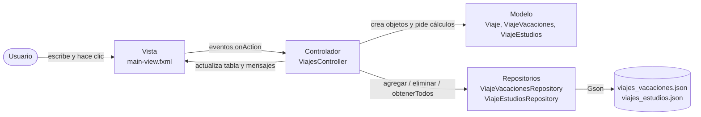
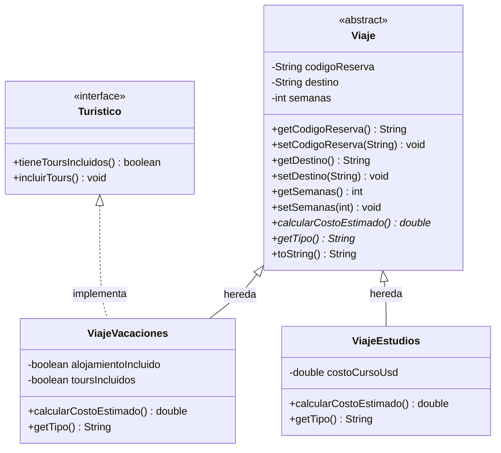
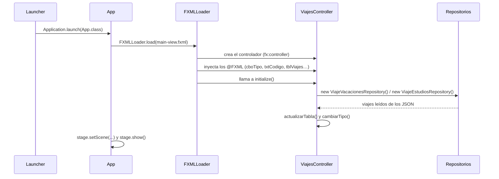
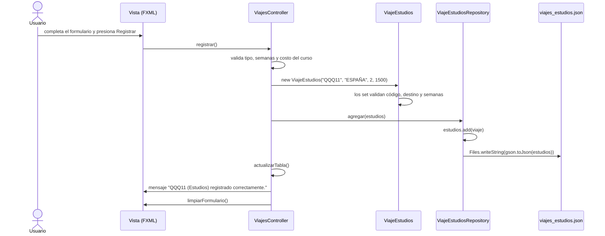

# Registro de Viajes: solución explicada

**DSY1102 Programación Orientada a Objetos · Evaluación formativa de preparación para la Evaluación Parcial 2**

Este documento explica, paso a paso, cómo está construida la solución del ejercicio **Registro de Viajes**: qué hace cada clase, qué conceptos de POO aparecen en el código, cómo se aplica la arquitectura **Modelo-Vista-Controlador (MVC)** y cómo se guardan los datos en archivos **JSON** con la librería **Gson**.

Léelo con el proyecto abierto en IntelliJ: cada sección indica el archivo y el método del que habla.

---

## Contenido

1. [Qué hace la aplicación](#1-qué-hace-la-aplicación)
2. [Cómo ejecutarla](#2-cómo-ejecutarla)
3. [Estructura del proyecto](#3-estructura-del-proyecto)
4. [Conceptos de POO en el modelo](#4-conceptos-de-poo-en-el-modelo)
5. [Arquitectura MVC](#5-arquitectura-mvc)
6. [Persistencia en JSON con Gson](#6-persistencia-en-json-con-gson)
7. [Validaciones](#7-validaciones)
8. [Recorrido completo: qué pasa al presionar Registrar](#8-recorrido-completo-qué-pasa-al-presionar-registrar)
9. [Relación con la pauta de evaluación](#9-relación-con-la-pauta-de-evaluación)
10. [Detalles a mejorar en esta versión](#10-detalles-a-mejorar-en-esta-versión)
11. [Preguntas de repaso](#11-preguntas-de-repaso)

---

## 1. Qué hace la aplicación

Una persona que viaja con frecuencia quiere llevar el registro de sus viajes. Cada viaje puede ser por **vacaciones** o por **estudios**.

| Dato | Vacaciones | Estudios |
|---|:---:|:---:|
| Código de reserva (no vacío) | ✔ | ✔ |
| Destino (no vacío) | ✔ | ✔ |
| Semanas que dura el viaje (1 a 54) | ✔ | ✔ |
| ¿Alojamiento incluido? (sí/no) | ✔ | |
| ¿Tours incluidos? (sí/no) | ✔ | |
| Costo del curso en dólares (500 a 8000) | | ✔ |

Cada tipo de viaje calcula su **costo estimado** con una regla distinta:

| Tipo | Regla | Ejemplo |
|---|---|---|
| Vacaciones | USD 800 por semana; si incluye alojamiento, **+25 %** | 10 semanas con alojamiento → 800 × 10 × 1,25 = **USD 10.000** |
| Estudios | Costo del curso **+ USD 250** de manutención por semana | Curso de 1500, 2 semanas → 1500 + 250 × 2 = **USD 2.000** |

La aplicación tiene **una sola ventana** con:

- un **formulario** para registrar viajes, con un selector de tipo que habilita solo los datos de ese tipo;
- una **tabla** con todos los viajes (Tipo, Código, Destino, Semanas, Costo);
- un botón **Eliminar**, que quita el viaje seleccionado en la tabla;
- un **área de mensajes**, que informa el resultado de cada acción.

Los viajes se guardan en dos archivos JSON, así que **siguen ahí al cerrar y volver a abrir** la aplicación.

---

## 2. Cómo ejecutarla

1. Abre la carpeta del proyecto en IntelliJ IDEA como proyecto **Maven** y verifica que el JDK sea **21**.
2. Si es la primera vez, recarga Maven (ícono *Load Maven Changes*) para que descargue JavaFX y Gson.
3. Ejecuta la clase **`Launcher`** (botón ▶ junto a su `main`).

### ¿Por qué existe `Launcher` si ya existe `App`?

`App` extiende `Application`, la clase de JavaFX. Este proyecto **no tiene `module-info.java`**: JavaFX se carga desde el *classpath*. En esa situación, si el `main` está en una clase que extiende `Application`, Java se detiene con el error:

```
Error: JavaFX runtime components are missing, and are required to run this application
```

`Launcher` es una clase común (no extiende `Application`) cuyo único trabajo es lanzar `App`:

```java
public class Launcher {
    public static void main(String[] args) {
        Application.launch(App.class, args);
    }
}
```

Por eso **siempre se ejecuta `Launcher`**, nunca `App` directamente.

### Dependencias (`pom.xml`)

| Dependencia | Para qué sirve |
|---|---|
| `javafx-controls` | Controles gráficos: `TextField`, `ComboBox`, `TableView`, `Button`… |
| `javafx-fxml` | Cargar vistas desde archivos `.fxml` (diseñados en Scene Builder) |
| `gson` (2.11.0) | Convertir objetos Java a JSON y JSON a objetos Java |

```xml
<dependency>
    <groupId>com.google.code.gson</groupId>
    <artifactId>gson</artifactId>
    <version>2.11.0</version>
</dependency>
```

---

## 3. Estructura del proyecto

```
RegistroViajes_EP2_VF/
├── pom.xml                         ← dependencias (JavaFX + Gson)
├── viajes_vacaciones.json          ← datos de los viajes por vacaciones
├── viajes_estudios.json            ← datos de los viajes por estudios
└── src/main/
    ├── java/cl/duoc/viajes/
    │   ├── Launcher.java           ← punto de entrada (main)
    │   ├── App.java                ← arranque JavaFX: carga la vista y abre la ventana
    │   ├── model/                  ← MODELO: reglas del negocio
    │   │   ├── Turistico.java          (interfaz)
    │   │   ├── Viaje.java              (clase abstracta)
    │   │   ├── ViajeVacaciones.java
    │   │   └── ViajeEstudios.java
    │   ├── controlador/            ← CONTROLADOR: coordina la vista con el modelo
    │   │   └── ViajesController.java
    │   └── repositorio/            ← PERSISTENCIA: lee y guarda los JSON
    │       ├── ViajeVacacionesRepository.java
    │       └── ViajeEstudiosRepository.java
    └── resources/cl/duoc/viajes/view/
        └── main-view.fxml          ← VISTA: la ventana, diseñada en Scene Builder
```

Cada paquete tiene **una sola responsabilidad**. Esa separación es la idea central de MVC (sección 5).



---

## 4. Conceptos de POO en el modelo

El paquete `model` contiene las reglas del negocio. **No sabe nada de ventanas ni de archivos**: no importa JavaFX ni Gson. Eso permite probarlo, reutilizarlo y cambiar la interfaz sin tocarlo.



### 4.1 Encapsulamiento

Los atributos son `private`: nadie fuera de la clase puede modificarlos directamente. Para leerlos o cambiarlos hay que pasar por los métodos `get` y `set`, y los `set` **validan** antes de guardar:

```java
public void setSemanas(int semanas) {
    if (semanas < 1 || semanas > 54) {
        throw new IllegalArgumentException("Las semanas deben estar entre 1 y 54.");
    }
    this.semanas = semanas;
}
```

Así es **imposible** tener un `Viaje` con 0 o 100 semanas: el objeto protege su propio estado. Lo mismo ocurre con el código de reserva y el destino, que no pueden ser nulos ni vacíos (`trim().isEmpty()` detecta también un texto formado solo por espacios).

> **Idea clave:** el encapsulamiento no es "poner getters y setters a todo"; es que **el objeto decide qué valores acepta**.

### 4.2 Abstracción y clase abstracta

`Viaje` representa la idea general de "un viaje". No tiene sentido crear un viaje que no sea ni de vacaciones ni de estudios, por eso es `abstract`:

```java
public abstract class Viaje {
    public abstract double calcularCostoEstimado();
    public abstract String getTipo();
}
```

- `new Viaje(...)` **no compila**: solo se pueden crear objetos de sus subclases.
- Los métodos `abstract` no tienen cuerpo: obligan a cada subclase a implementarlos. `Viaje` sabe *que* todo viaje tiene un costo, pero no *cómo* se calcula.

### 4.3 Herencia

`ViajeVacaciones` y `ViajeEstudios` **heredan** (`extends`) de `Viaje`: reciben sus atributos y métodos y agregan los propios.

```java
public class ViajeEstudios extends Viaje {
    private double costoCursoUsd;

    public ViajeEstudios(String codigoReserva, String destino, int semanas, double costoCursoUsd) {
        super(codigoReserva, destino, semanas);   // ← el constructor del padre valida los datos comunes
        setCostoCursoUsd(costoCursoUsd);
    }
}
```

`super(...)` llama al constructor de `Viaje`, que a su vez usa los `set` con validación. Así **las reglas comunes se escriben una sola vez**.

Como los atributos de `Viaje` son `private`, las subclases no pueden leer `semanas` directamente: usan `getSemanas()`:

```java
@Override
public double calcularCostoEstimado() {
    return costoCursoUsd + MANUTENCION_SEMANA * getSemanas();
}
```

### 4.4 Interfaces

`Turistico` es un **contrato**: cualquier clase que lo implemente promete tener esos métodos.

```java
public interface Turistico {
    boolean tieneToursIncluidos();
    void incluirTours();
}

public class ViajeVacaciones extends Viaje implements Turistico { ... }
```

Solo los viajes por vacaciones pueden incluir tours, por eso solo `ViajeVacaciones` implementa la interfaz. Una clase puede **heredar de una sola clase**, pero **implementar varias interfaces**.

| | Clase abstracta (`Viaje`) | Interfaz (`Turistico`) |
|---|---|---|
| ¿Tiene atributos? | Sí (`codigoReserva`, `destino`, `semanas`) | No (solo constantes) |
| ¿Tiene métodos con código? | Sí (getters, setters, `toString`) | No en este proyecto (solo firmas) |
| ¿Cuántas puede usar una clase? | Una (`extends`) | Varias (`implements`) |
| Expresa… | "**es un**" (un `ViajeEstudios` *es un* `Viaje`) | "**puede hacer**" (un `ViajeVacaciones` *puede* incluir tours) |

### 4.5 Polimorfismo y sobrescritura

**Sobrescribir** (`@Override`) es redefinir en la subclase un método heredado. Cada subclase da su propia versión de `calcularCostoEstimado()` y `getTipo()`:

```java
// ViajeVacaciones
@Override
public double calcularCostoEstimado() {
    double costo = COSTO_SEMANA * getSemanas();
    if (alojamientoIncluido) {
        return costo + costo * RECARGO_ALOJAMIENTO;
    }
    return costo;
}
```

**Polimorfismo** es que una misma llamada se comporte distinto según el objeto real:

```java
Viaje v1 = new ViajeVacaciones("DDD22", "BRASIL", 10, true);
Viaje v2 = new ViajeEstudios("QQQ11", "ESPAÑA", 2, 1500);

v1.calcularCostoEstimado();   // 10000.0  → usa la versión de ViajeVacaciones
v2.calcularCostoEstimado();   //  2000.0  → usa la versión de ViajeEstudios
```

Las variables son de tipo `Viaje`, pero Java ejecuta el método del **objeto real**. Gracias a esto, la tabla de la ventana es un `TableView<Viaje>` que muestra viajes de ambos tipos sin preguntar de qué tipo es cada uno.

La anotación `@Override` no es obligatoria, pero le pide al compilador que verifique que realmente estás sobrescribiendo un método. Si escribes mal el nombre, el error aparece al compilar y no en la ejecución.

### 4.6 `instanceof`: cuando sí importa el tipo real

A veces hay que saber el tipo concreto. Al eliminar, cada tipo de viaje se borra de **su** repositorio:

```java
if (seleccionado instanceof ViajeVacaciones vacaciones) {
    vacacionesRepository.eliminar(vacaciones);
} else if (seleccionado instanceof ViajeEstudios estudios) {
    estudiosRepository.eliminar(estudios);
}
```

`seleccionado instanceof ViajeVacaciones vacaciones` hace dos cosas: comprueba el tipo y, si coincide, crea la variable `vacaciones` ya convertida (*pattern matching*, disponible desde Java 16).

### 4.7 Constantes con `static final`

```java
private static final double COSTO_SEMANA = 800;
private static final double RECARGO_ALOJAMIENTO = 0.25;
```

Los valores fijos del negocio tienen nombre. `costo * RECARGO_ALOJAMIENTO` se entiende mejor que `costo * 0.25`, y si la tarifa cambia, se cambia en un solo lugar.

### 4.8 El constructor vacío

Cada clase del modelo tiene un constructor sin parámetros:

```java
/** Constructor sin parámetros, requerido para reconstruir objetos. */
public ViajeEstudios() {
}
```

Tu código no lo usa: lo usa **Gson** al leer el JSON, para crear el objeto antes de rellenar sus atributos (sección 6.3).

### 4.9 Excepciones

| Excepción | Tipo | Quién la lanza | Qué significa |
|---|---|---|---|
| `IllegalArgumentException` | *unchecked* (no obliga a `try/catch`) | Los `set` del modelo | Un dato no cumple una regla |
| `NumberFormatException` | *unchecked* | `Integer.parseInt`, `Double.parseDouble` | El texto no es un número |
| `IOException` | *checked* (obliga a declararla o capturarla) | `Files.readString`, `Files.writeString` | Falló la lectura o escritura del archivo |

Los repositorios declaran `throws IOException` y el controlador la captura para mostrar el error **en la ventana**, sin que la aplicación se detenga:

```java
} catch (IOException ex) {
    mostrarMensaje("Error al guardar los archivos de datos: " + ex.getMessage(), true);
}
```

---

## 5. Arquitectura MVC

**Modelo-Vista-Controlador** separa la aplicación en tres responsabilidades. A esta solución se le suma una cuarta capa, la **persistencia**.

| Capa | Archivo(s) | Responsabilidad | Lo que **no** hace |
|---|---|---|---|
| **Vista** | `main-view.fxml` | Define qué se ve: campos, tabla, botones | No tiene lógica ni cálculos |
| **Controlador** | `ViajesController` | Recibe los eventos, valida la entrada, coordina, muestra resultados | No calcula costos ni escribe archivos |
| **Modelo** | `Viaje`, `ViajeVacaciones`, `ViajeEstudios`, `Turistico` | Reglas del negocio y cálculos | No conoce la ventana ni los archivos |
| **Persistencia** | `ViajeVacacionesRepository`, `ViajeEstudiosRepository` | Leer y guardar los datos | No valida ni muestra mensajes |

¿Para qué separar? Si mañana el costo de las vacaciones cambia, solo se toca `ViajeVacaciones`. Si se quiere guardar en una base de datos en vez de JSON, solo cambian los repositorios. Si se rediseña la ventana, el modelo queda igual.

### 5.1 Ciclo de vida: de `Launcher` a la ventana



El orden importa: los atributos `@FXML` **todavía son `null` en el constructor** del controlador; recién están listos dentro de `initialize()`. Por eso toda la preparación inicial va ahí.

### 5.2 La Vista: `main-view.fxml`

La ventana se diseña en **Scene Builder**, no se programa. El FXML es un XML que describe los componentes:

```xml
<VBox ... fx:controller="cl.duoc.viajes.controlador.ViajesController">
    <ComboBox fx:id="cboTipo" onAction="#cambiarTipo" promptText="Seleccione..." />
    <TextField fx:id="txtCodigo" />
    ...
    <Button onAction="#registrar" text="Registrar" />
    <Button onAction="#eliminar" text="Eliminar" />
    <Label fx:id="lblMensaje" />
</VBox>
```

Tres atributos conectan la vista con el controlador:

| Atributo | Dónde se configura en Scene Builder | Qué hace |
|---|---|---|
| `fx:controller` | Panel *Controller* → *Controller class* | Indica qué clase controla esta vista. **Sin él, los `onAction` fallan** con *"No controller specified"* |
| `fx:id="txtCodigo"` | *Code* → *fx:id* | Conecta el componente con el atributo `@FXML private TextField txtCodigo;` (mismo nombre y tipo compatible) |
| `onAction="#registrar"` | *Code* → *On Action* | Al hacer clic, ejecuta el método `registrar()` del controlador |

#### Paneles por tipo

Los datos propios de cada tipo están dentro de dos `TitledPane` (`panelVacaciones` y `panelEstudios`). Deshabilitar el panel deshabilita **todo lo que contiene**:

```java
@FXML
private void cambiarTipo() {
    panelEstudios.setDisable(!"Estudios".equals(cboTipo.getValue()));
    panelVacaciones.setDisable(!"Vacaciones".equals(cboTipo.getValue()));
}
```

Se llama cuando cambia el selector (`onAction="#cambiarTipo"`) y también al final de `initialize()`, para que **al abrir la ventana** ambos paneles partan deshabilitados.

> Se escribe `"Estudios".equals(cboTipo.getValue())` y no `cboTipo.getValue().equals("Estudios")` porque `getValue()` es `null` mientras no se elige nada. Llamar un método sobre `null` lanza `NullPointerException`; en cambio, `"Estudios".equals(null)` simplemente devuelve `false`.

#### La tabla y `PropertyValueFactory`

Cada columna dice qué dato muestra:

```xml
<TableColumn text="Destino">
    <cellValueFactory><PropertyValueFactory property="destino" /></cellValueFactory>
</TableColumn>
```

`PropertyValueFactory` busca un **getter** con ese nombre en cada objeto de la tabla: `property="destino"` → llama a `getDestino()`. Para un `boolean` buscaría `isAlgo()`.

| `property` | Getter que se llama |
|---|---|
| `tipo` | `getTipo()` (método abstracto: polimorfismo) |
| `codigoReserva` | `getCodigoReserva()` |
| `destino` | `getDestino()` |
| `semanas` | `getSemanas()` |
| `costoCursoUsd` | `getCostoCursoUsd()`, ver la observación 10.1 |

Si el nombre no coincide con ningún getter, la columna aparece **vacía** y la aplicación sigue funcionando (solo queda un aviso en la consola). Es el error más común con tablas.

### 5.3 El Controlador: `ViajesController`

#### Atributos `@FXML`

```java
@FXML private ComboBox<String> cboTipo;
@FXML private TextField txtCodigo;
@FXML private TableView<Viaje> tblViajes;
@FXML private Label lblMensaje;
...
```

`@FXML` permite que `FXMLLoader` asigne a cada atributo el componente con el mismo `fx:id`, aunque el atributo sea `private`. Si falta la anotación o el nombre no coincide, el atributo queda en `null` y aparece un `NullPointerException` al usarlo.

#### `initialize()`: preparar la ventana

```java
@FXML
private void initialize() {
    cboTipo.getItems().addAll("Vacaciones", "Estudios");   // 1. opciones del selector
    tblViajes.setItems(viajes);                             // 2. la tabla muestra la lista observable
    try {
        vacacionesRepository = new ViajeVacacionesRepository();  // 3. cargar los JSON
        estudiosRepository = new ViajeEstudiosRepository();
        actualizarTabla();
        mostrarMensaje(" ", false);
    } catch (IOException e) {
        mostrarMensaje("Error al leer los archivos de datos: " + e.getMessage(), true);
    }
    cambiarTipo();                                          // 4. paneles deshabilitados al inicio
}
```

#### Colección observable: por qué la tabla se actualiza sola

```java
private final ObservableList<Viaje> viajes = FXCollections.observableArrayList();
```

Una `ObservableList` es una lista que **avisa** cuando cambia. La tabla se conecta a ella una sola vez (`tblViajes.setItems(viajes)`) y, desde ese momento, cada `clear()` o `addAll()` se refleja en pantalla **de inmediato**, sin recargar la ventana.

```java
private void actualizarTabla() {
    viajes.clear();
    if (vacacionesRepository != null) {
        viajes.addAll(vacacionesRepository.obtenerTodos());
    }
    if (estudiosRepository != null) {
        viajes.addAll(estudiosRepository.obtenerTodos());
    }
}
```

La tabla une los viajes de **los dos repositorios** en una sola lista de `Viaje`, gracias a la herencia. Se usa siempre la **misma** lista: no se crea una nueva en cada operación.

#### `mostrarMensaje(...)`: retroalimentación en la ventana

```java
private void mostrarMensaje(String texto, boolean error) {
    lblMensaje.setText(texto);
    lblMensaje.getStyleClass().removeAll("mensaje-ok", "mensaje-error");
    lblMensaje.getStyleClass().add(error ? "mensaje-error" : "mensaje-ok");
}
```

Todos los resultados, buenos o malos, se muestran en `lblMensaje`. **Nunca por consola**: el usuario de una aplicación de escritorio no ve la consola. Cada mensaje reemplaza al anterior.

`error ? "mensaje-error" : "mensaje-ok"` es el **operador ternario**: un `if/else` que devuelve un valor.

#### `eliminar()`

```java
@FXML
private void eliminar() {
    Viaje seleccionado = tblViajes.getSelectionModel().getSelectedItem();
    if (seleccionado == null) {
        mostrarMensaje("Debe seleccionar un viaje de la tabla para eliminarlo.", true);
        return;                               // sin selección: no se cambia nada
    }
    ...
}
```

`getSelectionModel().getSelectedItem()` devuelve el objeto de la fila seleccionada, o `null` si no hay ninguna. El `return` temprano corta el método antes de tocar los datos.

#### `limpiarFormulario()`

Después de un registro exitoso, el formulario queda vacío y los paneles vuelven a deshabilitarse (`cambiarTipo()`), listo para el siguiente registro. Ante un error **no** se limpia, para que el usuario pueda corregir.

---

## 6. Persistencia en JSON con Gson

### 6.1 ¿Qué es JSON?

**JSON** (*JavaScript Object Notation*) es un formato de texto para guardar datos estructurados. Un objeto va entre `{ }` con pares `"nombre": valor`, y una lista va entre `[ ]`.

`viajes_estudios.json`, con dos viajes:

```json
[
  {
    "costoCursoUsd": 1500.0,
    "codigoReserva": "QQQ11",
    "destino": "ESPAÑA",
    "semanas": 2
  },
  {
    "costoCursoUsd": 5000.0,
    "codigoReserva": "TOTO33",
    "destino": "PUNTA CANA",
    "semanas": 3
  }
]
```

Observa:

- Cada **atributo** del objeto se guardó con su nombre exacto (`codigoReserva`, `semanas`…).
- También se guardan los atributos **heredados** de `Viaje` (`codigoReserva`, `destino`, `semanas`), después de los propios de la subclase.
- **El costo estimado no se guarda**: no es un atributo, se **calcula** cada vez con `calcularCostoEstimado()`. Gson guarda **atributos**, no el resultado de los métodos.
- Un archivo vacío de datos contiene `[]`, una lista sin elementos.

### 6.2 ¿Por qué dos archivos?

Porque Gson, al **leer**, necesita saber qué clase crear. Si todos los viajes estuvieran en un solo archivo, Gson vería un objeto con `"semanas": 2` y no sabría si es un `ViajeVacaciones` o un `ViajeEstudios`; y `Viaje` no se puede instanciar porque es abstracta. Con un archivo por tipo, cada repositorio sabe exactamente qué clase leer:

```java
ViajeEstudios[] datos = gson.fromJson(json, ViajeEstudios[].class);
```

### 6.3 Gson: de objeto a JSON y de JSON a objeto

| Operación | Método | Ejemplo |
|---|---|---|
| **Serializar** (objeto → texto JSON) | `gson.toJson(objeto)` | `gson.toJson(estudios)` → `"[ { ... }, { ... } ]"` |
| **Deserializar** (texto JSON → objeto) | `gson.fromJson(texto, Clase.class)` | `gson.fromJson(json, ViajeEstudios[].class)` → arreglo de `ViajeEstudios` |

```java
private final Gson gson = new GsonBuilder().setPrettyPrinting().create();
```

`setPrettyPrinting()` escribe el JSON con saltos de línea y sangría, para que sea legible al abrir el archivo.

Al deserializar, Gson:

1. crea el objeto con el **constructor vacío** (sección 4.8);
2. asigna cada atributo **directamente**, aunque sea `private`, sin pasar por los `set`.

Por el punto 2, **las validaciones de los `set` no se ejecutan al leer el archivo**: si alguien edita el JSON a mano y escribe `"semanas": 99`, ese viaje se carga igual. Por eso nunca se edita el JSON a mano: los datos entran por la aplicación, que sí valida.

### 6.4 Los repositorios

Un **repositorio** centraliza el acceso a los datos de un tipo de objeto. El controlador no sabe que existen archivos: solo le pide al repositorio *dame todos*, *agrega este* o *elimina este*.

```java
public class ViajeEstudiosRepository {
    private final Path archivo = Path.of("viajes_estudios.json");
    private final ObservableList<ViajeEstudios> estudios = FXCollections.observableArrayList();
    private final Gson gson = new GsonBuilder().setPrettyPrinting().create();

    public ViajeEstudiosRepository() throws IOException {
        cargar();                                   // al crearse, lee el archivo
    }

    private void cargar() throws IOException {
        if (!Files.exists(archivo)) {
            Files.writeString(archivo, "[]");       // primera vez: crea el archivo vacío
            return;
        }
        String json = Files.readString(archivo);
        ViajeEstudios[] datos = gson.fromJson(json, ViajeEstudios[].class);
        if (datos != null) {
            estudios.addAll(datos);
        }
    }

    public ObservableList<ViajeEstudios> obtenerTodos() { return estudios; }

    public void agregar(ViajeEstudios viaje) throws IOException {
        estudios.add(viaje);
        guardar();                                  // guardado automático
    }

    public void eliminar(ViajeEstudios viaje) throws IOException {
        estudios.remove(viaje);
        guardar();
    }

    private void guardar() throws IOException {
        Files.writeString(archivo, gson.toJson(estudios));
    }
}
```

| Método | Cuándo se usa | Qué hace con el archivo |
|---|---|---|
| constructor → `cargar()` | Una vez, en `initialize()` | Lo lee; si no existe, lo crea con `[]` |
| `obtenerTodos()` | Cada vez que se actualiza la tabla | Nada: devuelve la lista en memoria |
| `agregar(...)` | Al registrar | Agrega a la lista y **reescribe todo el archivo** |
| `eliminar(...)` | Al eliminar | Quita de la lista y **reescribe todo el archivo** |

Dos ideas importantes:

- **La lista en memoria y el archivo siempre coinciden.** Cada cambio se guarda de inmediato, sin un botón "Guardar". Si la aplicación se cierra de golpe, no se pierde nada.
- **Se reescribe el archivo completo** cada vez, no solo el viaje nuevo. Es simple y, para pocos datos, suficientemente rápido.

`ViajeVacacionesRepository` es idéntico, cambiando el tipo (`ViajeVacaciones`) y el archivo (`viajes_vacaciones.json`).

### 6.5 Rutas: ¿dónde queda el archivo?

`Path.of("viajes_estudios.json")` es una ruta **relativa**: se resuelve desde la **carpeta de trabajo** del programa. Al ejecutar desde IntelliJ, esa carpeta es la **raíz del proyecto**, junto al `pom.xml`. Por eso los JSON aparecen ahí.

### 6.6 Clases de `java.nio.file` usadas

| Método | Qué hace |
|---|---|
| `Path.of("archivo.json")` | Representa la ruta del archivo |
| `Files.exists(ruta)` | `true` si el archivo existe |
| `Files.readString(ruta)` | Lee todo el archivo como un `String` |
| `Files.writeString(ruta, texto)` | Escribe el texto; si el archivo ya existe, **lo reemplaza** |

---

## 7. Validaciones

La solución valida en **dos niveles**:

1. **El controlador** revisa el formulario antes de crear el objeto y muestra un mensaje que dice **qué campo** falló y **por qué**.
2. **El modelo** vuelve a validar en sus `set`. Si algo se escapa del controlador, el modelo lanza `IllegalArgumentException` y el controlador muestra ese mensaje:

```java
} catch (IllegalArgumentException ex) {
    mostrarMensaje(ex.getMessage(), true); // respaldo: validación del modelo
}
```

| Orden | Campo | Regla | Dónde se valida |
|:---:|---|---|---|
| 1 | Tipo | Debe estar seleccionado | Controlador |
| 2 | Código de reserva | No vacío ni solo espacios | Modelo (ver 10.2) |
| 3 | Destino | No vacío ni solo espacios | Modelo (ver 10.2) |
| 4 | Semanas | Entero entre 1 y 54 | Controlador y modelo |
| 5 | Costo del curso (solo estudios) | Número entre 500 y 8000 | Controlador |

### Convertir texto en número

Todo lo que se escribe en un `TextField` es texto (`String`). Para usarlo como número hay que convertirlo, y la conversión **falla** si el texto no es un número:

```java
int semanas;
try {
    semanas = Integer.parseInt(txtSemanas.getText().trim());
} catch (NumberFormatException e) {
    semanas = -1;           // valor imposible: lo atrapa la validación de rango
}
if (semanas < 1 || semanas > 54) {
    mostrarMensaje("Semanas:debe ser un número entero entre 1 y 54", true);
    return;
}
```

El truco de asignar `-1` cuando la conversión falla permite tratar **en un solo `if`** los dos errores posibles: "no es un número" y "está fuera de rango".

Para el costo del curso, `.replace(',', '.')` acepta que el usuario escriba `1500,50` con coma decimal, como es habitual en Chile:

```java
costoCurso = Double.parseDouble(txtCosto.getText().trim().replace(',', '.'));
```

Los campos de un tipo **no se validan cuando se eligió el otro tipo**: el costo del curso solo se lee dentro del `else` de "Estudios".

---

## 8. Recorrido completo: qué pasa al presionar Registrar

Ejemplo: se registra un viaje de estudios a España, de 2 semanas, con un curso de USD 1500.



1. `onAction="#registrar"` ejecuta `registrar()` en el controlador.
2. El controlador verifica que los repositorios se hayan cargado y que haya un tipo elegido.
3. Convierte y valida las semanas y, por ser "Estudios", el costo del curso.
4. Crea el objeto `ViajeEstudios`. Su constructor llama a `super(...)`, y los `set` de `Viaje` validan código, destino y semanas.
5. Le entrega el objeto al **repositorio de estudios**, que lo agrega a su lista y reescribe `viajes_estudios.json`.
6. `actualizarTabla()` recarga la lista observable y la tabla muestra el nuevo viaje.
7. El área de mensajes confirma el registro y el formulario se limpia.

Si algo falla en los pasos 2 a 5, el método termina con un mensaje de error y **no se registra nada**.

---

## 9. Relación con la pauta de evaluación

| Indicador | Dónde se evidencia en esta solución |
|---|---|
| IE 2.1.1 Configuración del proyecto | Gson agregado al `pom.xml`; se ejecuta desde `Launcher`; `App` carga `view/main-view.fxml` |
| IE 2.2.1 Vista declarada en FXML | `main-view.fxml` con selector, campos comunes, paneles por tipo, tabla, botones y mensajes |
| IE 2.2.2 Vinculación vista–controlador | `fx:controller`, `fx:id` y atributos `@FXML` con el mismo nombre |
| IE 2.3.1 Inicialización y eventos | `initialize()` carga el selector y deshabilita paneles; `onAction` en selector y botones |
| IE 2.3.2 Retroalimentación visual | `mostrarMensaje(...)` en `lblMensaje` para cada resultado |
| IE 2.4.1 Paquetes separados | `model`, `controlador`, `repositorio` y `view` en recursos |
| IE 2.4.2 Delegación | El costo lo calcula el modelo; los archivos los manejan los repositorios |
| IE 2.5.1 Colección observable | `ObservableList<Viaje> viajes`, asignada una vez a la tabla |
| IE 2.5.2 Columnas con datos del modelo | `PropertyValueFactory` en cada columna (revisa 10.1) |
| IE 2.5.3 Cambios inmediatos en la tabla | `actualizarTabla()` después de registrar y eliminar |
| IE 2.6.1 y 2.6.2 Validación | Sección 7 |
| IE 2.7.1 y 2.7.2 Persistencia | Sección 6 (y las mejoras de 10.3 y 10.4) |
| IE 2.8.1 Integración | Flujo completo de la sección 8 |

---

## 10. Detalles a mejorar en esta versión

Esta solución funciona y cubre el flujo completo, pero tiene algunos detalles que vale la pena revisar. Encontrarlos y corregirlos es un buen ejercicio antes de la evaluación.

### 10.1 La columna "Costo" muestra un valor incorrecto en los viajes de estudios

La columna usa `property="costoCursoUsd"`, que llama a `getCostoCursoUsd()`. Ese método existe **dos veces**:

```java
// En Viaje: devuelve el costo estimado
public double getCostoCursoUsd() {
    return calcularCostoEstimado();
}

// En ViajeEstudios: SOBRESCRIBE el anterior y devuelve solo el valor del curso
public double getCostoCursoUsd() {
    return costoCursoUsd;
}
```

Como `ViajeEstudios` tiene un método con el mismo nombre, **lo sobrescribe** (sección 4.5). Para un viaje por estudios, la tabla muestra el costo del curso y no el costo estimado:

| Viaje | Costo estimado correcto | Lo que muestra la tabla |
|---|---|---|
| DDD22 (vacaciones, 10 semanas, con alojamiento) | 10.000 | 10.000 ✔ |
| QQQ11 (estudios, 2 semanas, curso 1500) | 2.000 | **1.500** ✘ |
| TOTO33 (estudios, 3 semanas, curso 5000) | 5.750 | **5.000** ✘ |

Es polimorfismo funcionando, solo que sin querer. **Corrección:** darle al método de `Viaje` un nombre propio y usarlo en la columna.

```java
// Viaje.java
public double getCostoEstimado() {
    return calcularCostoEstimado();
}
```

```xml
<!-- main-view.fxml -->
<TableColumn text="Costo estimado">
    <cellValueFactory><PropertyValueFactory property="costoEstimado" /></cellValueFactory>
</TableColumn>
```

### 10.2 El controlador no detecta un código o destino vacío

```java
if (txtCodigo.getText() == null) { ... }
```

Un `TextField` vacío devuelve `""` (texto vacío), **no** `null`, así que esta condición nunca se cumple. Hoy el error lo termina detectando el modelo, con su propio mensaje, y solo después de validar las semanas. **Corrección:**

```java
if (txtCodigo.getText() == null || txtCodigo.getText().trim().isEmpty()) {
    mostrarMensaje("Código de reserva: no puede estar vacío ni contener solo espacios.", true);
    return;
}
```

Lo mismo para `txtDestino`.

### 10.3 Los repositorios dependen de JavaFX y no usan una interfaz DAO

Los repositorios guardan los viajes en una `ObservableList`, que es una clase de **JavaFX**. La capa de persistencia queda así amarrada a la interfaz gráfica: no podría reutilizarse en una aplicación web o de consola. La pauta pide además una **interfaz DAO** con las operaciones de lectura y escritura, y una implementación que use Gson.

Diseño sugerido:

```java
// dao/ViajeDao.java: el contrato
public interface ViajeDao<T> {
    List<T> leerTodos() throws IOException;
    void guardarTodos(List<T> viajes) throws IOException;
}

// dao/JsonViajeDao.java: la implementación con Gson (lee y escribe el archivo)

// repositorio/ViajeEstudiosRepository.java: trabaja con List y delega en el DAO
private final ViajeDao<ViajeEstudios> dao = new JsonViajeDao<>("viajes_estudios.json", ViajeEstudios.class);
private final List<ViajeEstudios> estudios = new ArrayList<>();
```

La `ObservableList` queda solo en el controlador, que es el único que habla con la vista. De paso, el comentario de `ViajeEstudiosRepository` (*"delega en el DAO… No depende de JavaFX"*) describiría correctamente el código.

### 10.4 Si falla el guardado, la memoria y el archivo dejan de coincidir

`agregar` primero modifica la lista y después guarda. Si `guardar()` lanza `IOException`, el viaje queda en memoria y se ve en la tabla, pero no en el archivo. **Corrección:** deshacer el cambio si falla el guardado.

```java
public void agregar(ViajeEstudios viaje) throws IOException {
    estudios.add(viaje);
    try {
        guardar();
    } catch (IOException ex) {
        estudios.remove(viaje);   // se restablece la consistencia
        throw ex;
    }
}
```

### 10.5 Detalles menores

- **Mensajes sin color:** `mostrarMensaje` asigna las clases CSS `mensaje-ok` y `mensaje-error`, pero la vista no tiene una hoja de estilos. Se puede crear `view/estilos.css` y asociarla al nodo raíz en Scene Builder (*Properties* → *Stylesheets*):
  ```css
  .mensaje-ok    { -fx-text-fill: #1b7a2f; -fx-font-weight: bold; }
  .mensaje-error { -fx-text-fill: #c62828; -fx-font-weight: bold; }
  ```
- **Imports sin uso:** `ViajeEstudiosRepository` importa `Viaje` y `ViajeVacacionesRepository` importa `ViajeEstudios`, y ninguno de los dos los usa. IntelliJ los marca en gris; se eliminan con *Code* → *Optimize Imports*.
- **Texto del mensaje:** `"Semanas:debe ser…"` necesita un espacio después de los dos puntos.
- **Selector después de limpiar:** tras `clearSelection()`, el `ComboBox` puede quedar en blanco en vez de mostrar *"Seleccione..."*. Es un comportamiento conocido de JavaFX, no un error de tu código.

### 10.6 Para seguir practicando

- Impide que se repita un **código de reserva**, aunque el viaje repetido sea de otro tipo. Pista: un método `existeCodigo(String)` en cada repositorio, consultado por el controlador antes de registrar.
- Agrega una columna **"Tours"** que muestre *Sí* o *No* solo para los viajes por vacaciones.
- Agrega un campo de **búsqueda por destino** que filtre la tabla con una `FilteredList`.

---

## 11. Preguntas de repaso

1. ¿Por qué `Viaje` es una clase abstracta y no una clase normal? ¿Qué pasa si intentas escribir `new Viaje(...)`?
2. ¿Qué diferencia hay entre `extends` e `implements`? ¿Por qué `ViajeEstudios` no implementa `Turistico`?
3. Explica con un ejemplo de este proyecto qué es el polimorfismo.
4. ¿Por qué la aplicación se ejecuta desde `Launcher` y no desde `App`?
5. ¿Qué tres atributos del FXML conectan la vista con el controlador y qué hace cada uno?
6. ¿En qué momento se puede usar un atributo `@FXML`: en el constructor o en `initialize()`? ¿Por qué?
7. ¿Por qué la tabla muestra un viaje nuevo sin que tengas que recargarla?
8. ¿Por qué hay dos archivos JSON en vez de uno solo?
9. ¿Por qué el costo estimado no aparece en el archivo JSON?
10. Si borras `viajes_estudios.json` y abres la aplicación, ¿qué ocurre y qué línea del código lo explica?
11. ¿Qué capa tendrías que modificar si el costo por semana de las vacaciones subiera a USD 900? ¿Y si los datos se guardaran en una base de datos?
12. En la observación 10.1, ¿qué concepto de POO explica que la columna muestre un valor distinto según el tipo de viaje?
