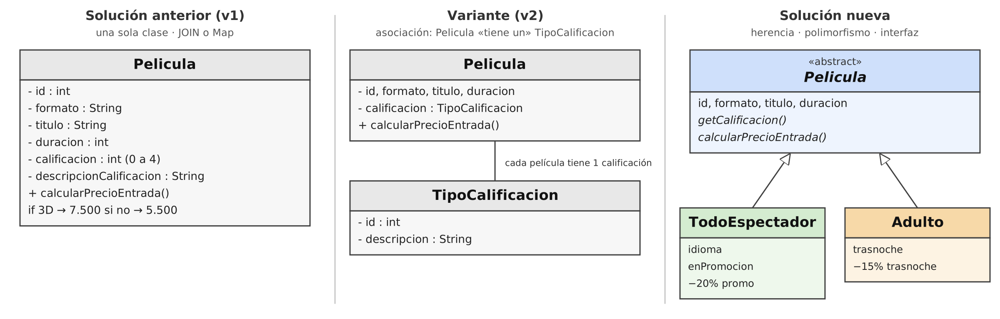
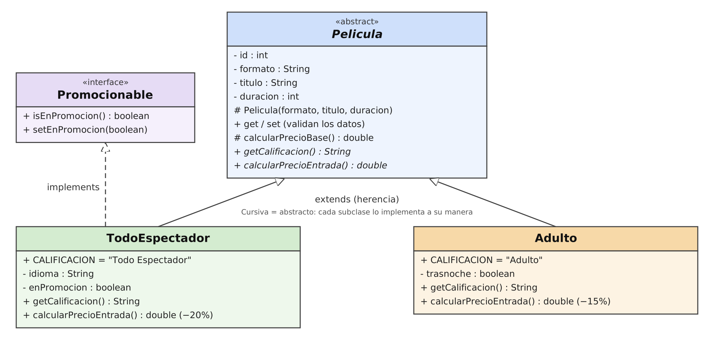
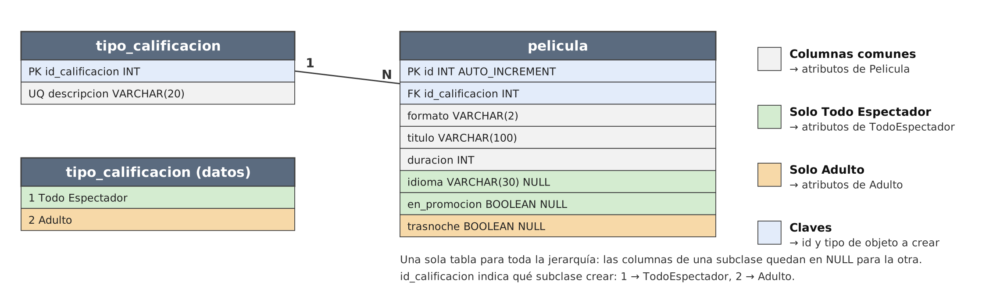
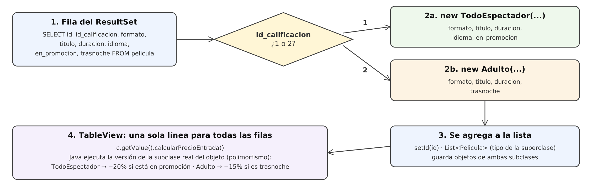

# CineEstrella EP3: solución con herencia explicada

**DSY1102 Desarrollo Orientado a Objetos · Experiencia de Aprendizaje 3 · Preparación para la Evaluación 3**

Este documento explica la solución de **CineEstrella**, una aplicación JavaFX que **registra, lista, edita y elimina películas guardadas en una base de datos**. Las películas se modelan con **herencia**: una clase abstracta `Pelicula` y dos subclases, `TodoEspectador` y `Adulto`, que salen de la tabla `tipo_calificacion`.

El ejercicio viene de una solución anterior de CineEstrella que **no tenía herencia**. A lo largo del documento se compara con esa versión para mostrar **qué concepto de Orientación a Objetos aparece en cada cambio y qué problema resuelve**.

Léelo con el proyecto abierto en IntelliJ. Los recuadros **📘 Concepto OO** explican la teoría en el lugar del código donde se usa.

---

## Contenido

1. [Qué hace la aplicación](#1-qué-hace-la-aplicación)
2. [Cómo ejecutarla](#2-cómo-ejecutarla)
3. [Estructura del proyecto](#3-estructura-del-proyecto)
4. [De dónde venimos: la solución sin herencia](#4-de-dónde-venimos-la-solución-sin-herencia)
5. [El modelo: herencia, abstracción y polimorfismo](#5-el-modelo-herencia-abstracción-y-polimorfismo)
6. [La base de datos: una tabla para toda la jerarquía](#6-la-base-de-datos-una-tabla-para-toda-la-jerarquía)
7. [Acceso a datos: interfaz PeliculaDAO y PeliculaJdbcDAO](#7-acceso-a-datos-interfaz-peliculadao-y-peliculajdbcdao)
8. [El controlador: trabajar con la superclase](#8-el-controlador-trabajar-con-la-superclase)
9. [Recorrido completo: registrar una película](#9-recorrido-completo-registrar-una-película)
10. [Resumen: conceptos OO antes y ahora](#10-resumen-conceptos-oo-antes-y-ahora)
11. [Errores frecuentes](#11-errores-frecuentes)
12. [Para seguir practicando](#12-para-seguir-practicando)
13. [Preguntas de repaso](#13-preguntas-de-repaso)

---

## 1. Qué hace la aplicación

| Zona | Qué contiene |
|---|---|
| Formulario (izquierda) | Calificación, Formato, Título y Duración, que son comunes a todas las películas. Debajo, los datos propios de cada calificación: **Idioma** y **En promoción familiar** para Todo Espectador, y **Función trasnoche** para Adulto |
| Tabla (derecha) | ID, Calificación, Formato, Título, Duración y **Precio entrada** |
| Botones | Registrar o Guardar cambios, Cancelar edición, Editar, Eliminar |
| Área de mensajes (abajo) | Avisos de éxito, información o error |

Al elegir la calificación, el formulario **habilita solo los campos de esa calificación**. Al editar una película, la calificación queda bloqueada, porque **un objeto no puede cambiar de clase**: una película `Adulto` no se convierte en `TodoEspectador`.

### Reglas del precio de la entrada

| Calificación | Precio base (según formato) | Regla propia |
|---|---|---|
| Todo Espectador | 2D $5.500 · 3D $7.500 | **−20 %** si está en promoción familiar |
| Adulto | 2D $5.500 · 3D $7.500 | **−15 %** si es función trasnoche |

Con los datos iniciales del script:

| Película | Calificación | Formato | Condición | Precio |
|---|---|---|---|---|
| Coco | Todo Espectador | 2D | en promoción | $4.400 |
| Avatar | Todo Espectador | 3D | sin promoción | $7.500 |
| Oppenheimer | Adulto | 2D | trasnoche | $4.675 |
| Dune | Adulto | 3D | sin trasnoche | $7.500 |
| Up | Todo Espectador | 2D | sin promoción | $5.500 |

---

## 2. Cómo ejecutarla

1. Ejecuta `scripts/cineestrella_mysql.sql` completo en MySQL. Si usas Oracle, ejecuta `scripts/cineestrella_oracle.sql` en SQL Developer con F5.
2. Completa `URL`, `USUARIO` y `CLAVE` en `conexion/ConexionBD.java`.
3. Revisa que `pom.xml` tenga el conector de tu motor (`mysql-connector-j` u `ojdbc11`) y recarga Maven.
4. Ejecuta la clase **`Launcher`**. No ejecutes `App`: sin `module-info.java`, ejecutar una clase que extiende `Application` produce *JavaFX runtime components are missing*.

---

## 3. Estructura del proyecto

```
CineEstrella_EP3_Solucion/
├── pom.xml                         JavaFX + conector JDBC (marca "Modificación del estudiante")
├── LEEME.txt                       instrucciones para el estudiante
├── SOLUCION_DOCENTE.txt            qué construye y qué completa el estudiante
├── scripts/
│   ├── cineestrella_mysql.sql
│   └── cineestrella_oracle.sql
└── src/main/
    ├── java/cl/duoc/cineestrella/
    │   ├── Launcher.java, App.java          inicio de la aplicación
    │   ├── model/
    │   │   ├── Pelicula.java                clase ABSTRACTA (superclase)
    │   │   ├── TodoEspectador.java          subclase · implementa Promocionable
    │   │   ├── Adulto.java                  subclase
    │   │   └── Promocionable.java           INTERFAZ
    │   ├── dao/
    │   │   ├── PeliculaDAO.java             INTERFAZ: contrato de acceso a datos
    │   │   ├── PeliculaJdbcDAO.java         implementación JDBC (la construye el estudiante)
    │   │   └── PersistenciaException.java   excepción propia
    │   ├── conexion/
    │   │   └── ConexionBD.java              URL, usuario y clave
    │   └── controller/
    │       └── MainController.java          eventos, formulario y tabla
    └── resources/cl/duoc/cineestrella/view/
        └── main-view.fxml
```

| Archivo | Quién lo trabaja en la evaluación |
|---|---|
| `PeliculaJdbcDAO.java` | **Lo construye el estudiante** |
| `pom.xml`, `ConexionBD.java`, `MainController.java` | El estudiante completa lo marcado con *"Modificación del estudiante"* |
| Modelo, `PeliculaDAO`, `PersistenciaException`, vista, scripts | Se entregan listos; no se modifican |

---

## 4. De dónde venimos: la solución sin herencia



### 4.1 Solución anterior (v1): una sola clase

En la primera versión de CineEstrella había **una sola clase** `Pelicula`, que representaba todas las películas por igual:

```java
public class Pelicula {
    private int id;
    private String formato;
    private String titulo;
    private int duracion;
    private int calificacion;                 // código 0 a 4
    private String descripcionCalificacion;   // "Desde los 12 años"... (no se guarda)

    public double calcularPrecioEntrada() {
        if (FORMATO_3D.equals(formato)) {
            return PRECIO_3D;
        }
        return PRECIO_2D;
    }
}
```

- `tipo_calificacion` tenía **5 filas**, de 0 *Todo Espectador* a 4 *Mayores de Edad*.
- La calificación era **solo un dato**: un `int` y un `String`. No cambiaba el comportamiento de la película.
- Para mostrar la descripción, el DAO tenía dos propuestas: un **JOIN** entre `pelicula` y `tipo_calificacion`, o un **Map** `Map<Integer, String>` cargado con un `SELECT` del catálogo.
- `PeliculaDAO` era una **clase concreta**, sin interfaz, y `PersistenciaException` extendía `RuntimeException`.

### 4.2 Variante (v2): una clase por tabla

Después se probó una versión intermedia: **una clase por cada tabla**. `TipoCalificacion` tenía `id` y `descripcion`, y `Pelicula` tenía un atributo `TipoCalificacion calificacion`. Es una **asociación** (*una película tiene una calificación*). El DAO buscaba la fila del catálogo con `WHERE id = ?`.

Esta versión representa mejor la base de datos, pero **todas las películas siguen comportándose igual**. La calificación sigue siendo un dato que se muestra, no algo que cambie lo que la película hace.

### 4.3 Solución nueva: la calificación define el tipo de objeto

El cambio de fondo es de **pregunta de diseño**. Antes la pregunta era *"¿qué calificación tiene esta película?"* y la respuesta era un número. Ahora es *"¿qué clase de película es?"*, y la respuesta es **una clase**:

| | v1 (sin herencia) | Nueva (con herencia) |
|---|---|---|
| Calificaciones | 5, solo como dato | 2, cada una es una **subclase** |
| Datos propios de cada tipo | No había: todas tienen los mismos atributos | `TodoEspectador`: `idioma`, `enPromocion` · `Adulto`: `trasnoche` |
| Precio | Un solo cálculo, con un `if` por formato | Cada subclase **sobrescribe** `calcularPrecioEntrada()` con su regla |
| Descripción de la calificación | Se leía de `tipo_calificacion` (JOIN o Map) | La conoce cada subclase: `getCalificacion()` |
| Cómo se distingue el tipo | Comparando el `int calificacion` | Por la **clase del objeto** (`instanceof`) |
| Acceso a datos | Clase concreta `PeliculaDAO` | Interfaz `PeliculaDAO` + implementación `PeliculaJdbcDAO` |
| `PersistenciaException` | `RuntimeException` (*unchecked*) | `Exception` (*checked*) |

> **¿Cuándo conviene herencia?** Cuando los tipos **se comportan distinto** o **tienen datos distintos**. Si las 5 calificaciones de la v1 solo cambiaran el texto, crear 5 subclases vacías sería exceso de diseño: bastaba con un dato. Aquí cada calificación tiene atributos y una regla de precio propios, y por eso la herencia sí se justifica.

---

## 5. El modelo: herencia, abstracción y polimorfismo



**Cómo leer el diagrama:**

| Símbolo | Significa |
|---|---|
| `-` | `private` |
| `+` | `public` |
| `#` | `protected` |
| Texto en *cursiva* | Clase o método **abstracto** |
| Flecha continua con triángulo | `extends` (herencia) |
| Flecha punteada con triángulo | `implements` (interfaz) |

### 5.1 Pelicula: una clase abstracta

```java
public abstract class Pelicula {

    private int id;
    private String formato;
    private String titulo;
    private int duracion;

    protected Pelicula(String formato, String titulo, int duracion) {
        setFormato(formato);
        setTitulo(titulo);
        setDuracion(duracion);
    }

    protected double calcularPrecioBase() {
        return FORMATO_3D.equals(formato) ? PRECIO_3D : PRECIO_2D;
    }

    public abstract String getCalificacion();
    public abstract double calcularPrecioEntrada();
}
```

> **📘 Concepto OO: abstracción y clase abstracta**
> **Abstraer** es quedarse con lo esencial y común. En el cine no existe una película "genérica": toda película es *Todo Espectador* o *Adulto*. Por eso `Pelicula` es **`abstract`**:
> - **No se puede instanciar**: `new Pelicula(...)` no compila.
> - **Reúne lo común**: id, formato, título y duración, sus validaciones y el precio base.
> - **Obliga** a sus subclases a implementar los métodos `abstract`, que no tienen cuerpo.
>
> En la v1, `Pelicula` era una clase concreta y se podía crear con `new Pelicula()`, porque era la única.

### 5.2 Encapsulamiento: los datos se protegen en los `set`

```java
public void setDuracion(int duracion) {
    if (duracion < DURACION_MINIMA || duracion > DURACION_MAXIMA) {
        throw new IllegalArgumentException("La duración debe estar entre 60 y 240 minutos.");
    }
    this.duracion = duracion;
}
```

> **📘 Concepto OO: encapsulamiento**
> Los atributos son `private` y solo se cambian a través de métodos que **validan**. El constructor también usa los `set`, así que **no puede existir una película con datos inválidos**, ni siquiera recién creada. Esto ya estaba en la v1. Lo nuevo es que, con herencia, **las validaciones comunes se escriben una sola vez** en la superclase y las dos subclases las reciben.
>
> Además, las subclases **no pueden tocar directamente** `titulo` o `duracion`, porque son `private` en `Pelicula`. Deben usar los métodos heredados. El encapsulamiento también rige entre padre e hijo.

### 5.3 Herencia: `extends` y `super(...)`

```java
public class Adulto extends Pelicula {

    public static final String CALIFICACION = "Adulto";
    private static final double DESCUENTO_TRASNOCHE = 0.15;

    private boolean trasnoche;

    public Adulto(String formato, String titulo, int duracion, boolean trasnoche) {
        super(formato, titulo, duracion);   // primero se construye la parte "Pelicula"
        this.trasnoche = trasnoche;         // luego lo propio de Adulto
    }
}
```

> **📘 Concepto OO: herencia (relación "es un")**
> `Adulto extends Pelicula` se lee **"un Adulto *es una* Película"**. La subclase **hereda** todo lo público y protegido de la superclase: `getTitulo()`, `setDuracion()`, `calcularPrecioBase()`… Además **agrega** lo suyo (`trasnoche`) y **especializa** lo que debe comportarse distinto (`calcularPrecioEntrada()`).
>
> - **`super(...)`** llama al constructor de la superclase y **debe ser la primera línea** del constructor. Así se reutilizan las validaciones de formato, título y duración.
> - El constructor de `Pelicula` es **`protected`**: solo lo pueden llamar sus subclases.
>
> **Prueba de la herencia correcta:** si la frase "X *es un* Y" suena natural, la herencia tiene sentido. "Un Adulto es una Película" funciona. "Una Película es una Calificación" no: por eso en la v2 la relación entre esas dos clases era una **asociación** ("tiene un") y no herencia.

### 5.4 Métodos abstractos y sobrescritura (`@Override`)

```java
// En TodoEspectador
@Override
public double calcularPrecioEntrada() {
    double precio = calcularPrecioBase();          // método heredado (protected)
    if (enPromocion) {
        precio -= precio * DESCUENTO_PROMOCION;    // −20 %
    }
    return precio;
}

// En Adulto
@Override
public double calcularPrecioEntrada() {
    double precio = calcularPrecioBase();
    if (trasnoche) {
        precio -= precio * DESCUENTO_TRASNOCHE;    // −15 %
    }
    return precio;
}
```

> **📘 Concepto OO: sobrescritura (*override*)**
> Una subclase **redefine** un método de la superclase con la **misma firma**, es decir, el mismo nombre, los mismos parámetros y el mismo tipo de retorno. La anotación `@Override` le pide al compilador que verifique que de verdad se está sobrescribiendo. Si se escribe mal el nombre, por ejemplo `calcularPrecioentrada`, aparece un error en vez de un método nuevo que nadie llama.
>
> Como los métodos son **abstractos** en `Pelicula`, sobrescribirlos es **obligatorio**. Si `Adulto` no implementara `calcularPrecioEntrada()`, no compilaría, salvo que también fuera abstracta.

**¿Por qué `calcularPrecioBase()` es `protected`?** La regla "2D $5.500 y 3D $7.500" es común a ambas subclases, así que se escribe **una vez** en la superclase y cada subclase la reutiliza. Es `protected` porque es un detalle interno del cálculo: las subclases lo necesitan, pero el controlador no.

En la v1, ese cálculo era **todo** el método `calcularPrecioEntrada()`. Ahora es la **base** sobre la que cada subclase aplica su regla.

### 5.5 Polimorfismo: una sola llamada, distinto comportamiento

En el controlador, la columna de precio tiene **una sola línea** para todas las filas:

```java
colPrecio.setCellValueFactory(c ->
        new SimpleStringProperty(formatearPrecio(c.getValue().calcularPrecioEntrada())));
```

`c.getValue()` es de tipo `Pelicula`. El controlador **no sabe ni pregunta** si es `TodoEspectador` o `Adulto`, y aun así Coco muestra $4.400 (−20 %) y Oppenheimer $4.675 (−15 %).

> **📘 Concepto OO: polimorfismo**
> *Poli* (muchas) + *morfos* (formas). Una variable del tipo de la **superclase** puede guardar objetos de **cualquier subclase**. Al llamar un método sobrescrito, Java ejecuta **la versión de la clase real del objeto**, no la del tipo de la variable. Esto se decide durante la ejecución y se llama **enlace dinámico** (*dynamic binding*).
>
> ```java
> Pelicula p1 = new TodoEspectador("2D", "Coco", 105, "Español", true);
> Pelicula p2 = new Adulto("2D", "Oppenheimer", 180, true);
> p1.calcularPrecioEntrada();   // 4400.0 → versión de TodoEspectador
> p2.calcularPrecioEntrada();   // 4675.0 → versión de Adulto
> p1.getCalificacion();         // "Todo Espectador"
> ```
>
> **Comparación con la v1:** si en la versión sin herencia se quisieran descuentos distintos por calificación, habría que agregar `if (calificacion == ...)` dentro de `calcularPrecioEntrada()`, y otro `if` cada vez que apareciera una regla nueva. Con polimorfismo, **cada clase es responsable de su propia regla** y el código que la usa no cambia.

Lo mismo pasa con `getCalificacion()`. En la v1, el texto "Todo Espectador" se leía de la base de datos con JOIN o Map. Ahora **cada subclase lo sabe** por su constante `CALIFICACION`, y la columna Calificación de la tabla también es una llamada polimórfica.

### 5.6 La interfaz Promocionable

```java
public interface Promocionable {
    boolean isEnPromocion();
    void setEnPromocion(boolean enPromocion);
}

public class TodoEspectador extends Pelicula implements Promocionable { ... }
```

> **📘 Concepto OO: interfaz**
> Una interfaz es un **contrato**: declara *qué* puede hacer una clase, sin decir *cómo*. La clase que la implementa (`implements`) **se compromete** a escribir todos sus métodos.
>
> **¿Por qué no poner `enPromocion` en `Pelicula`?** Porque no todas las películas pueden estar en promoción familiar: solo las de Todo Espectador. Ponerlo en la superclase le daría a `Adulto` un atributo sin sentido.
>
> **¿Herencia o interfaz?**
>
> | | Herencia (`extends`) | Interfaz (`implements`) |
> |---|---|---|
> | Expresa | Lo que la clase **es** | Lo que la clase **puede hacer** |
> | Cuántas | Una sola superclase | Varias interfaces |
> | Aporta | Atributos y métodos con código | Un contrato de métodos |
> | Ejemplo | `TodoEspectador` **es una** `Pelicula` | `TodoEspectador` **es** `Promocionable` |
>
> Si mañana se crea otra subclase que también admita promociones, basta con que implemente `Promocionable`. Un código que reciba un `Promocionable` funcionará con ambas sin conocerlas.

### 5.7 Constantes `CALIFICACION` y el formulario

```java
public static final String CALIFICACION = "Todo Espectador";   // en TodoEspectador
public static final String CALIFICACION = "Adulto";            // en Adulto
```

`static final` significa que la constante **pertenece a la clase**, no a cada objeto, y **no cambia**. Se usa así:

- **`getCalificacion()`** la retorna.
- **El `ComboBox` del formulario** se llena con ellas: `TodoEspectador.CALIFICACION` y `Adulto.CALIFICACION`.
- **El controlador** compara la opción elegida con ellas para saber qué objeto crear.

El texto está escrito **en un solo lugar**: si cambia, cambia en todos.

---

## 6. La base de datos: una tabla para toda la jerarquía



```sql
CREATE TABLE tipo_calificacion (
    id_calificacion  INT          NOT NULL,
    descripcion      VARCHAR(20)  NOT NULL,
    CONSTRAINT pk_tipo_calificacion PRIMARY KEY (id_calificacion),
    CONSTRAINT uq_tipo_calificacion_descripcion UNIQUE (descripcion)
);

CREATE TABLE pelicula (
    id               INT           NOT NULL AUTO_INCREMENT,
    id_calificacion  INT           NOT NULL,
    formato          VARCHAR(2)    NOT NULL,
    titulo           VARCHAR(100)  NOT NULL,
    duracion         INT           NOT NULL,
    idioma           VARCHAR(30)   NULL,     -- solo Todo Espectador
    en_promocion     BOOLEAN       NULL,     -- solo Todo Espectador
    trasnoche        BOOLEAN       NULL,     -- solo Adulto
    CONSTRAINT pk_pelicula PRIMARY KEY (id),
    CONSTRAINT fk_pelicula_calificacion FOREIGN KEY (id_calificacion)
        REFERENCES tipo_calificacion (id_calificacion),
    CONSTRAINT ck_pelicula_formato CHECK (formato IN ('2D', '3D')),
    CONSTRAINT ck_pelicula_duracion CHECK (duracion BETWEEN 60 AND 240)
);
```

### Del mundo de objetos al mundo de tablas

Las bases de datos relacionales **no tienen herencia**. Para guardar una jerarquía de clases hay varias estrategias. Este proyecto usa la más simple, **una sola tabla para toda la jerarquía** (*single table inheritance*), la misma que PataVerde usa con `mascota`:

| Columnas | Corresponden a | En una fila de la otra subclase |
|---|---|---|
| `formato`, `titulo`, `duracion` | Atributos de `Pelicula` (superclase) | Siempre tienen valor |
| `idioma`, `en_promocion` | Atributos de `TodoEspectador` | Quedan en `NULL` en una película Adulto |
| `trasnoche` | Atributo de `Adulto` | Queda en `NULL` en una película Todo Espectador |
| `id_calificacion` | **La clase del objeto** | 1 → `TodoEspectador`, 2 → `Adulto` |

`id_calificacion` hace de **discriminador**: es la columna que le dice al DAO qué subclase crear al leer cada fila.

### La relación entre tablas

`pelicula.id_calificacion` es **clave foránea** de `tipo_calificacion.id_calificacion`. La relación es **uno a muchos (1:N)**: una calificación puede estar en muchas películas, y cada película tiene una sola calificación. La clave foránea impide guardar una película con una calificación inexistente, por ejemplo 7.

**Comparación con la v1:** la tabla `tipo_calificacion` sigue existiendo y sigue protegiendo la integridad, pero **la aplicación ya no la lee**. En la v1 se consultaba para obtener la descripción. Ahora la descripción vive en cada subclase, y el catálogo y las constantes `CALIFICACION` dicen lo mismo.

---

## 7. Acceso a datos: interfaz PeliculaDAO y PeliculaJdbcDAO

### 7.1 La interfaz: programar contra un contrato

```java
public interface PeliculaDAO {
    List<Pelicula> obtenerTodos() throws PersistenciaException;
    void insertar(Pelicula pelicula) throws PersistenciaException;
    void actualizar(Pelicula pelicula) throws PersistenciaException;
    void eliminar(int id) throws PersistenciaException;
}
```

> **📘 Concepto OO: programar contra una interfaz**
> El controlador declara su atributo con el tipo de la **interfaz**:
> ```java
> private final PeliculaDAO dao = new PeliculaJdbcDAO();
> ```
> Es la **única línea** que menciona JDBC. Si mañana las películas se guardaran en un archivo JSON, se escribiría `PeliculaJsonDAO implements PeliculaDAO`, se cambiaría ese `new`, y el resto del controlador no se tocaría.
>
> Es el mismo polimorfismo del modelo, aplicado a la capa de datos: `dao.insertar(...)` ejecuta la versión de la clase real.
>
> **En la v1**, `PeliculaDAO` era directamente la clase que hacía el JDBC, y el controlador quedaba **atado a esa implementación**.

Los métodos reciben y retornan **`Pelicula`**, la superclase. La interfaz no necesita un `insertarAdulto` y un `insertarTodoEspectador`: **un solo método sirve para ambas subclases** gracias al polimorfismo.

### 7.2 PersistenciaException: excepción *checked*

```java
public class PersistenciaException extends Exception { ... }
```

| | v1 | Nueva |
|---|---|---|
| Extiende | `RuntimeException` (*unchecked*) | `Exception` (*checked*) |
| ¿El compilador obliga a manejarla? | No | **Sí**: cada método la declara con `throws`, y quien llama debe capturarla con `try/catch` |

En ambos casos el DAO **envuelve** la `SQLException` original:

```java
throw new PersistenciaException("No fue posible registrar la película.", e);
```

Así el controlador no depende de JDBC, el mensaje para el usuario es claro y la causa técnica no se pierde. Que sea *checked* hace visible en la firma que el método **puede fallar**, y el compilador no deja olvidar el manejo del error.

### 7.3 Leer: de una fila a la subclase correcta



```java
private static final int CALIFICACION_TODO_ESPECTADOR = 1;
private static final int CALIFICACION_ADULTO = 2;

@Override
public List<Pelicula> obtenerTodos() throws PersistenciaException {
    List<Pelicula> peliculas = new ArrayList<>();
    try (Connection conexion = ConexionBD.getConnection();
         PreparedStatement ps = conexion.prepareStatement(SQL_SELECT);
         ResultSet rs = ps.executeQuery()) {
        while (rs.next()) {
            peliculas.add(crearPelicula(rs));
        }
        return peliculas;
    } catch (SQLException e) {
        throw new PersistenciaException("No fue posible conectarse a la base de datos.", e);
    }
}

/** Crea un TodoEspectador o un Adulto a partir de la fila actual, según su id_calificacion. */
private Pelicula crearPelicula(ResultSet rs) throws SQLException {
    Pelicula pelicula;
    if (rs.getInt("id_calificacion") == CALIFICACION_TODO_ESPECTADOR) {
        pelicula = new TodoEspectador(rs.getString("formato"), rs.getString("titulo"), rs.getInt("duracion"),
                rs.getString("idioma"), rs.getBoolean("en_promocion"));
    } else {
        pelicula = new Adulto(rs.getString("formato"), rs.getString("titulo"), rs.getInt("duracion"),
                rs.getBoolean("trasnoche"));
    }
    pelicula.setId(rs.getInt("id"));
    return pelicula;
}
```

**Puntos clave:**

- **Es el único lugar donde se pregunta por el tipo al leer.** El discriminador `id_calificacion` decide qué constructor usar, y desde ahí el objeto *ya sabe* lo que es.
- **Upcasting automático.** La variable `pelicula` es de tipo `Pelicula`, pero guarda un `TodoEspectador` o un `Adulto`. Asignar una subclase a una variable de la superclase no necesita conversión.
- **`List<Pelicula>`** guarda objetos de ambas subclases mezclados. Es la colección polimórfica que recibe la tabla.
- **`setId` va al final**, porque el `id` lo generó la base de datos y no forma parte de los constructores.
- **Los constructores validan.** Si en la base hubiera un dato inválido, por ejemplo duración 30, el objeto no se crearía. El modelo protege su consistencia también al leer.
- **`try-with-resources`** cierra automáticamente `ResultSet`, `PreparedStatement` y `Connection`, en orden inverso, aunque ocurra un error.

**Comparación con la v1:**

| v1 (JOIN) | Nueva |
|---|---|
| `SELECT ... FROM pelicula p JOIN tipo_calificacion t ON t.id = p.calificacion` | `SELECT ... FROM pelicula`, solo la tabla `pelicula` |
| Se creaba siempre `new Pelicula()` y se completaba con `set` | Se crea **la subclase** que corresponde a la fila |
| `setDescripcionCalificacion(rs.getString("descripcion"))` | No hace falta: la subclase ya conoce su descripción |

### 7.4 Guardar: de la subclase a la fila (`instanceof`)

```java
/** Asigna los parámetros 1 a 7 (columnas comunes y propias de la calificación). */
private void asignarParametros(PreparedStatement ps, Pelicula pelicula) throws SQLException {
    ps.setString(2, pelicula.getFormato());
    ps.setString(3, pelicula.getTitulo());
    ps.setInt(4, pelicula.getDuracion());
    if (pelicula instanceof TodoEspectador todoEspectador) {
        ps.setInt(1, CALIFICACION_TODO_ESPECTADOR);
        ps.setString(5, todoEspectador.getIdioma());
        ps.setBoolean(6, todoEspectador.isEnPromocion());
        ps.setNull(7, Types.INTEGER);
    } else {
        Adulto adulto = (Adulto) pelicula;
        ps.setInt(1, CALIFICACION_ADULTO);
        ps.setNull(5, Types.VARCHAR);
        ps.setNull(6, Types.INTEGER);
        ps.setBoolean(7, adulto.isTrasnoche());
    }
}
```

| Parámetro | `INSERT` | `UPDATE` |
|---|---|---|
| 1 | `id_calificacion` | `id_calificacion` |
| 2 – 4 | `formato`, `titulo`, `duracion` | ídem |
| 5 – 6 | `idioma`, `en_promocion` | ídem |
| 7 | `trasnoche` | ídem |
| 8 | — | `id`, en el `WHERE` |

`insertar` y `actualizar` comparten `asignarParametros`. `actualizar` solo agrega `ps.setInt(8, pelicula.getId())`. Reutilizar código evita que una de las dos operaciones quede desactualizada.

> **📘 Concepto OO: `instanceof` y *downcasting***
> El parámetro es una `Pelicula`, que no tiene `getIdioma()`. Para acceder a lo propio de la subclase hay que **preguntar** qué es el objeto y **convertir** la referencia (*downcasting*):
> - **`pelicula instanceof TodoEspectador todoEspectador`** (*pattern matching*, Java 16+) pregunta **y** declara la variable ya convertida, en una sola línea.
> - **`(Adulto) pelicula`** es un *cast* explícito. Es seguro aquí porque, si no es `TodoEspectador`, solo puede ser `Adulto`. Si se hiciera un *cast* equivocado, Java lanzaría `ClassCastException`.
>
> **¿Polimorfismo o `instanceof`?** Lo ideal es que el objeto **haga** las cosas por sí mismo, como en `calcularPrecioEntrada()`. Aquí el `instanceof` se justifica porque decidir qué columnas de la tabla llenar es responsabilidad de la **capa de datos**, no del modelo: la clase `Adulto` no debe saber que existe una columna `trasnoche` en MySQL.

> **`setNull`.** Las columnas de la otra subclase se envían como `NULL` explícito, con su tipo SQL: `Types.VARCHAR` para texto y `Types.INTEGER` para los lógicos, compatible con MySQL y con Oracle `NUMBER(1)`. Al **actualizar**, esto también limpia valores antiguos.

---

## 8. El controlador: trabajar con la superclase

### 8.1 La tabla trabaja con `Pelicula`

```java
@FXML private TableView<Pelicula> tabla;
@FXML private TableColumn<Pelicula, String> colCalificacion;
...
colCalificacion.setCellValueFactory(c -> new SimpleStringProperty(c.getValue().getCalificacion()));
colPrecio.setCellValueFactory(c ->
        new SimpleStringProperty(formatearPrecio(c.getValue().calcularPrecioEntrada())));
```

La tabla es de **`Pelicula`**. Las columnas Calificación y Precio son llamadas **polimórficas** (sección 5.5). Las demás columnas usan métodos **heredados**: `getTitulo()`, `getFormato()`…

### 8.2 Crear el objeto desde el formulario

```java
private Pelicula crearPeliculaDesdeFormulario() {
    String calificacion = cbCalificacion.getValue();
    if (calificacion == null) {
        throw new IllegalArgumentException("Selecciona la calificación de la película.");
    }
    String formato = cbFormato.getValue();
    if (formato == null) {
        throw new IllegalArgumentException("Selecciona el formato de la película.");
    }
    String titulo = txtTitulo.getText();
    int duracion = leerEntero(txtDuracion.getText(), "La duración debe ser un número entero de minutos.");

    if (TodoEspectador.CALIFICACION.equals(calificacion)) {
        return new TodoEspectador(formato, titulo, duracion, txtIdioma.getText(), chkPromocion.isSelected());
    }
    return new Adulto(formato, titulo, duracion, chkTrasnoche.isSelected());
}
```

- **El controlador no repite las validaciones.** Solo revisa lo que el modelo no puede revisar: que se haya elegido una opción y que el texto sea un número. Título vacío o duración fuera de rango los rechazan los **constructores** con `IllegalArgumentException`, y `onRegistrar()` muestra ese mensaje. **Cada regla vive en un solo lugar.**
- **Retorna `Pelicula`**, por lo que `onRegistrar()` llama a `dao.insertar(pelicula)` sin saber qué subclase es.

### 8.3 Campos según la calificación y edición

```java
private void actualizarCamposPorCalificacion() {
    boolean esTodoEspectador = TodoEspectador.CALIFICACION.equals(cbCalificacion.getValue());
    boolean esAdulto = Adulto.CALIFICACION.equals(cbCalificacion.getValue());
    txtIdioma.setDisable(!esTodoEspectador);
    chkPromocion.setDisable(!esTodoEspectador);
    chkTrasnoche.setDisable(!esAdulto);
}
```

En `onEditar()`, los datos comunes se cargan igual para todas las películas, y los propios se cargan con `instanceof`, igual que en el DAO:

```java
if (seleccionada instanceof TodoEspectador todoEspectador) {
    txtIdioma.setText(todoEspectador.getIdioma());
    chkPromocion.setSelected(todoEspectador.isEnPromocion());
} else if (seleccionada instanceof Adulto adulto) {
    chkTrasnoche.setSelected(adulto.isTrasnoche());
}
```

Durante la edición, `cbCalificacion` queda **deshabilitado**: en Java, **un objeto no cambia de clase**. Para pasar una película de Todo Espectador a Adulto habría que eliminarla y registrarla de nuevo, o crear un objeto nuevo de la otra subclase.

---

## 9. Recorrido completo: registrar una película

Ejemplo: *Alien*, Adulto, 3D, 117 minutos, función trasnoche.

1. **Calificación.** El usuario elige **Adulto**. `actualizarCamposPorCalificacion()` habilita *Función trasnoche* y deshabilita *Idioma* y *Promoción*.
2. **Registrar.** `onRegistrar()` llama a `crearPeliculaDesdeFormulario()`.
3. **Creación del objeto.** Como la opción es `Adulto.CALIFICACION`, se ejecuta `new Adulto("3D", "Alien", 117, true)`.
   - `super(...)` valida formato, título y duración en `Pelicula`.
   - Luego se asigna `trasnoche`.
   - Si algo es inválido, la `IllegalArgumentException` llega al controlador, que muestra el mensaje en rojo.
4. **Guardado.** `dao.insertar(pelicula)` ejecuta la versión de `PeliculaJdbcDAO` (polimorfismo de interfaz).
5. **Parámetros.** `asignarParametros` detecta con `instanceof` que no es `TodoEspectador`. Hace el *cast* a `Adulto` y asigna `id_calificacion = 2`, `idioma = NULL`, `en_promocion = NULL` y `trasnoche = 1`.
6. **Base de datos.** `executeUpdate()` inserta la fila, y la base asigna el `id`.
7. **Recarga.** `cargarTabla()` llama a `obtenerTodos()`, que vuelve a crear un `Adulto` a partir de la fila (`id_calificacion = 2`).
8. **Tabla.** La tabla muestra **$6.375**: `calcularPrecioBase()` da $7.500 por 3D, y `Adulto.calcularPrecioEntrada()` le descuenta el 15 %.

---

## 10. Resumen: conceptos OO antes y ahora

| Concepto | Dónde aparece en la solución nueva | Cómo era en la v1 |
|---|---|---|
| **Abstracción / clase abstracta** | `Pelicula` es `abstract`, con `getCalificacion()` y `calcularPrecioEntrada()` abstractos | `Pelicula` concreta, única clase |
| **Encapsulamiento** | Atributos `private`, validación en los `set`; las subclases usan los métodos heredados | Igual, pero en una sola clase |
| **Herencia** | `TodoEspectador` y `Adulto` `extends Pelicula`, con `super(...)` | No había |
| **Modificador `protected`** | Constructor de `Pelicula` y `calcularPrecioBase()` | No se usaba |
| **Sobrescritura** | `@Override` de `calcularPrecioEntrada()` y `getCalificacion()` | Solo `toString()` |
| **Polimorfismo** | Columnas Calificación y Precio; `List<Pelicula>`; métodos del DAO que reciben `Pelicula` | La descripción venía de la BD y el precio de un `if` por formato |
| **Interfaz (modelo)** | `Promocionable`, implementada solo por `TodoEspectador` | No había |
| **Interfaz (capa de datos)** | `PeliculaDAO` + `PeliculaJdbcDAO` | `PeliculaDAO` era una clase concreta |
| **`instanceof` / *casting*** | DAO (`asignarParametros`) y controlador (`onEditar`) | No hacía falta: había un solo tipo |
| **Constantes de clase** | `CALIFICACION` en cada subclase y `FORMATO_2D` / `FORMATO_3D` | `FORMATO_2D` / `FORMATO_3D` |
| **Excepciones propias** | `PersistenciaException extends Exception` (*checked*) | `extends RuntimeException` (*unchecked*) |
| **Asociación** (relación "tiene un") | — | v2: `Pelicula` tenía un `TipoCalificacion` |

**La idea central:** en la v1, la calificación era un **dato** que la aplicación leía y mostraba. En la solución nueva, la calificación es un **tipo**: decide qué atributos tiene la película y cómo calcula su precio. Ese paso de "dato" a "tipo" es lo que justifica la herencia.

---

## 11. Errores frecuentes

| Síntoma o mensaje | Causa probable | Solución |
|---|---|---|
| `Pelicula is abstract; cannot be instantiated` | Se intentó `new Pelicula(...)` | Crear `new TodoEspectador(...)` o `new Adulto(...)` |
| `Adulto is not abstract and does not override abstract method ...` | La subclase no implementó un método abstracto | Implementar `getCalificacion()` y `calcularPrecioEntrada()` con `@Override` |
| `call to super must be first statement in constructor` | Hay código antes de `super(...)` | Mover `super(...)` a la primera línea del constructor |
| `titulo has private access in Pelicula` | La subclase accede al atributo directamente | Usar `getTitulo()` / `setTitulo()` |
| `cannot find symbol: method getIdioma()` | Se llama a un método de la subclase sobre una variable `Pelicula` | Usar `instanceof` y hacer el *cast* |
| `ClassCastException` | *Cast* a la subclase equivocada | Preguntar primero con `instanceof` |
| `unreported exception PersistenciaException` | Excepción *checked* sin manejar | Capturarla con `try/catch` o declararla con `throws` |
| Todas las películas se leen como Adulto | El `if` compara con un `id_calificacion` incorrecto | Revisar que 1 sea Todo Espectador y 2 Adulto, como en el script |
| Precio sin descuento | `en_promocion` o `trasnoche` se guardan en la columna equivocada | Revisar los números de parámetro en `asignarParametros` |
| `Cannot add or update a child row: a foreign key constraint fails` | `id_calificacion` que no existe en `tipo_calificacion` | Usar 1 o 2 |
| `Check constraint 'ck_pelicula_duracion' is violated` | Duración fuera de 60–240 | La validación del modelo debería impedirlo: revisar que se usen los `set` |
| `No suitable driver found` | Falta el conector en `pom.xml` | Agregar la dependencia y recargar Maven |
| `JavaFX runtime components are missing` | Se ejecutó `App` | Ejecutar `Launcher` |

---

## 12. Para seguir practicando

1. **Una tercera calificación.** Agrega `Infantil` (id 3) con un atributo `boolean incluyeCombo` y precio −10 % con combo.
   - ¿Qué archivos cambian? Las nuevas clase y fila del catálogo, una columna nueva, el `if` de `crearPelicula`, `asignarParametros`, el `ComboBox` y los campos del formulario.
   - ¿Qué **no** cambia? Las columnas de la tabla que usan polimorfismo. Ahí está el valor del diseño.
2. **Otra película promocionable.** Haz que `Infantil` también implemente `Promocionable`. Escribe un método `int contarEnPromocion(List<Pelicula> lista)` que use `instanceof Promocionable` y funcione sin conocer las subclases.
3. **`toString()` polimórfico.** Sobrescribe `toString()` en `Pelicula` usando `getCalificacion()` y `calcularPrecioEntrada()`, y compruébalo con un `System.out.println` de la lista completa.
4. **`switch` en el DAO.** Investiga cómo reemplazar el `if` de `crearPelicula` por un `switch` sobre `id_calificacion`. ¿Qué pasaría si la base trajera un 3 y no existiera esa subclase?
5. **Comparación.** Toma la v1 y agrega solo el descuento por promoción, sin herencia. Compara cuántos `if` aparecen y en cuántos lugares.

---

## 13. Preguntas de repaso

1. ¿Por qué `Pelicula` es abstracta? ¿Qué pasaría si no lo fuera?
2. ¿Qué hereda `Adulto` de `Pelicula` y qué agrega por su cuenta?
3. ¿Por qué el constructor de `Pelicula` es `protected` y no `public`?
4. Explica con el ejemplo de Coco y Oppenheimer qué es el polimorfismo.
5. ¿Qué diferencia hay entre sobrescribir y sobrecargar un método?
6. ¿Por qué `enPromocion` está en una interfaz y no en `Pelicula`?
7. En la v1, ¿de dónde salía el texto "Todo Espectador"? ¿Y ahora?
8. ¿Qué cumple la columna `id_calificacion` al leer y al guardar?
9. ¿Por qué las columnas `idioma`, `en_promocion` y `trasnoche` permiten `NULL`?
10. ¿Cuándo es necesario usar `instanceof` y por qué conviene usarlo lo menos posible?
11. ¿Por qué `PeliculaDAO` es una interfaz? ¿Qué ganó el controlador respecto de la v1?
12. ¿Qué diferencia hay entre una `PersistenciaException` *checked* y una *unchecked*?
13. ¿Por qué no se puede cambiar la calificación de una película al editarla?
14. Las 5 calificaciones de la v1, ¿debían ser 5 subclases? Justifica cuándo conviene herencia y cuándo basta un atributo.
