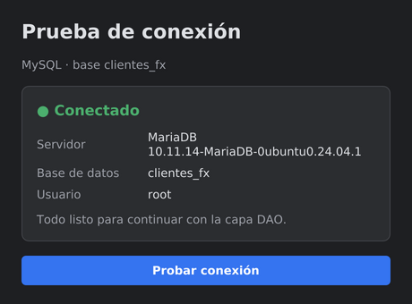
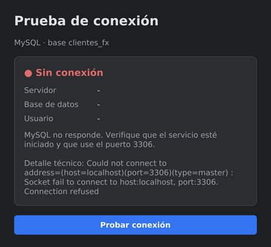

# PruebaConexionFX

Ejemplo previo a **GestorClientesFX** (Guía 3.2.3). Su único objetivo es comprobar que una aplicación JavaFX puede conectarse a MySQL, respetando MVC. No hay tabla, formulario ni DAO: eso viene en el siguiente ejemplo.

## Cómo ejecutarlo

1. Ejecuta `sql/clientes_fx.sql` en MySQL [XAMPP o Workbench]. Crea la base `clientes_fx`, que también usará GestorClientesFX.
2. Si tu usuario o contraseña de MySQL no son `root` / `1234`, cámbialos en `database/DatabaseConnection.java`.
3. Abre la carpeta en IntelliJ como proyecto Maven y recarga Maven.
4. Ejecuta la clase **`Launcher`**. La ventana prueba la conexión al abrirse; el botón **Probar conexión** la repite.

## Resultado esperado

| Con MySQL activo | Sin conexión |
| --- | --- |
|  |  |

Si no conecta, la ventana indica la causa más probable (MySQL apagado, contraseña incorrecta, base inexistente o conector faltante) y, debajo, el detalle técnico del error.

## Estructura (MVC)

```
src/main/java/org/example/pruebaconexionfx/
├── Launcher.java                       punto de entrada (main)
├── App.java                            carga la vista y abre la ventana
├── model/EstadoConexion.java           MODELO: resultado de la prueba (conectado, servidor, base, usuario)
├── database/DatabaseConnection.java    CONEXIÓN: URL, usuario y contraseña; probarConexion()
└── controller/ConexionController.java  CONTROLADOR: pide la prueba y muestra el resultado
src/main/resources/org/example/pruebaconexionfx/view/
├── conexion-view.fxml                  VISTA (Scene Builder)
└── estilo-oscuro.css
```

El controlador no escribe código JDBC: le pide a `DatabaseConnection` que pruebe la conexión y recibe un `EstadoConexion`, un objeto del modelo que la vista sabe mostrar.

## Qué se pasa a GestorClientesFX

- `DatabaseConnection.getConnection()` se reutiliza tal cual.
- La base `clientes_fx` ya queda creada.
- Se agregan el modelo `Cliente`, la capa `dao` y la tabla con el formulario.

## Si no conecta

| Mensaje | Solución |
| --- | --- |
| `Communications link failure` | Inicia el servicio MySQL y revisa que el puerto sea 3306 |
| `Access denied for user` | Corrige usuario y contraseña en `DatabaseConnection` |
| `Unknown database 'clientes_fx'` | Ejecuta `sql/clientes_fx.sql` |
| `No suitable driver found` | Recarga Maven y revisa que esté `mysql-connector-j`; no uses `module-info.java` |
